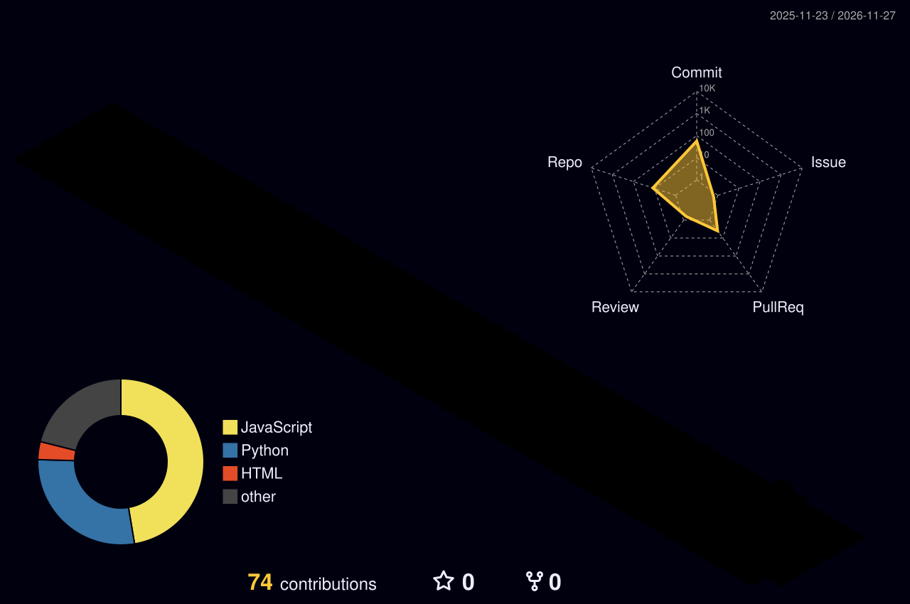

## About Me

Computer Science student specializing in Artificial Intelligence & Machine Learning. 
Passionate about building innovative solutions through AI, full-stack development, and automation. 
Exploring emerging technologies and transforming creative ideas into real-world products. 
Always learning, experimenting, and building projects that make an impact. 
Driven by curiosity, creativity, and a vision to build something meaningful.

## Tech Stack

## GitHub Stats

